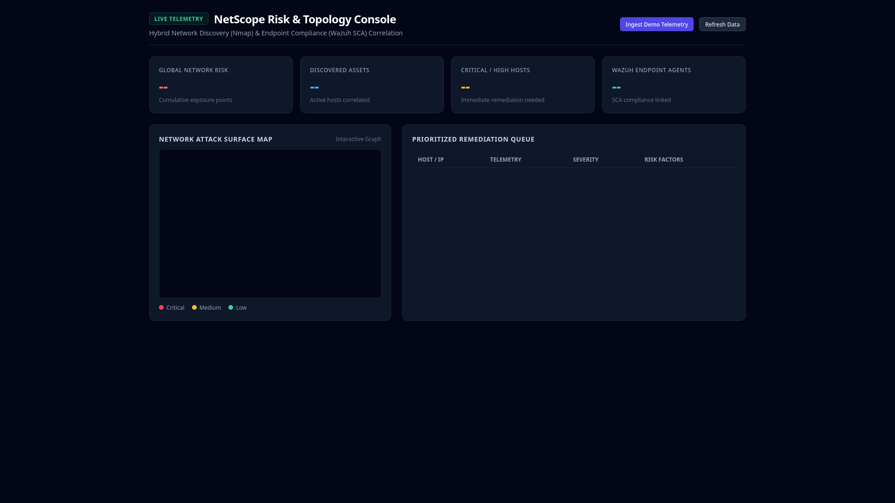

# 🛡️ NetScope: Network & Endpoint Risk Mapper



**NetScope** is a modular security posture and telemetry platform designed to bridge the gap between network discovery and endpoint compliance. Built as a home lab project simulating enterprise security engineering workflows, NetScope ingests multi-source telemetry, correlates network assets with endpoint security checks, and calculates prioritized executive risk scores.

---

## 🏗️ Architecture & Core Components

* **Backend API (`FastAPI`):** High-performance RESTful API with Pydantic validation and **SQLite** persistence via **SQLAlchemy ORM**.
* **Hybrid Sensor Ingestion:**
  * **Nmap Sensor:** Parses XML network scan exports to extract live hosts, MAC vendors, OS estimates, and open ports/services.
  * **Wazuh Sensor:** Ingests JSON agent telemetry (simulating Wazuh Syscheck & SCA) to track installed software packages and configuration compliance checks.
* **Identity Correlation Engine:** Automatically links network scan discoveries with endpoint telemetry using IP address and hostname resolution.
* **Risk & Prioritization Engine:** Evaluates asset exposure based on sensitive open ports (e.g., SSH, RDP), endpoint SCA compliance failures, and attack surface size.
* **Interactive Web Console (`/dashboard`):** Single-page telemetry and attack surface topology UI built with **Tailwind CSS** and **Cytoscape.js**.
* **CLI Dashboard (`netscope_cli.py`):** Custom command-line client for rapid telemetry inspection, scan drift detection, and executive risk reporting.

---

## 📂 Project Structure

```text
netscope/
├── backend/
│   ├── app/
│   │   ├── parsers/
│   │   │   ├── nmap_parser.py
│   │   │   └── wazuh_parser.py
│   │   ├── static/
│   │   │   └── index.html
│   │   ├── database.py
│   │   ├── models.py
│   │   ├── risk_engine.py
│   │   └── main.py
│   └── netscope_cli.py
├── scans/
│   ├── sample_scan.xml
│   └── sample_wazuh_agent.json
├── netscope_dashboard.png
└── README.md
```

---

## 🚀 Key Features

1. **Automated Asset Discovery:** Converts raw Nmap XML and Wazuh JSON outputs into a unified relational asset inventory.
2. **Network Drift Detection (`/api/v1/scans/compare-latest`):** Compares consecutive scans to detect rogue devices, offline hosts, or newly exposed services.
3. **Endpoint Compliance Correlation:** Enriches network hosts with installed package counts and Security Configuration Assessment (SCA) pass/fail metrics.
4. **Executive Risk Scoring (`/api/v1/risk/dashboard`):** Ranks assets by severity (`CRITICAL`, `HIGH`, `MEDIUM`, `LOW`) with clear remediation factors.
5. **Visual Attack Surface Topology (`/dashboard`):** Interactive node-link graph and prioritized remediation queue.

---

## ⚙️ Quickstart & Usage

### 1. Environment Setup & Server Launch
```bash
cd ~/Projects/programming-labs/python/netscope/backend
python -m venv venv
source venv/bin/activate
pip install fastapi uvicorn sqlalchemy pydantic

# Start the FastAPI server
PYTHONPATH=. python -m uvicorn app.main:app --reload --host 127.0.0.1 --port 8000
```

### 2. Ingest Telemetry & Run CLI Commands
In a second terminal session inside `backend/` (with `venv` active):

```bash
# Reset database to a clean state
python netscope_cli.py reset

# Ingest Nmap network discovery scan
curl -X POST "[http://127.0.0.1:8000/api/v1/ingest/nmap](http://127.0.0.1:8000/api/v1/ingest/nmap)"

# Ingest and correlate Wazuh endpoint telemetry
curl -X POST "[http://127.0.0.1:8000/api/v1/ingest/wazuh](http://127.0.0.1:8000/api/v1/ingest/wazuh)"

# Inspect unified asset inventory
python netscope_cli.py assets

# View prioritized executive risk report
python netscope_cli.py risk

# Check scan history and drift comparison
python netscope_cli.py scans
python netscope_cli.py diff
```

---

## 💡 Sales Engineering Value

* **Unified Visibility:** Eliminates silos between network infrastructure scanning and endpoint posture monitoring.
* **Actionable Prioritization:** Translates raw technical telemetry into business-ready severity rankings (`CRITICAL` to `LOW`) to guide remediation.
* **Extensible Design:** Built on a decoupled parser architecture ready for additional threat intelligence feeds (e.g., CISA KEV, EPSS).
